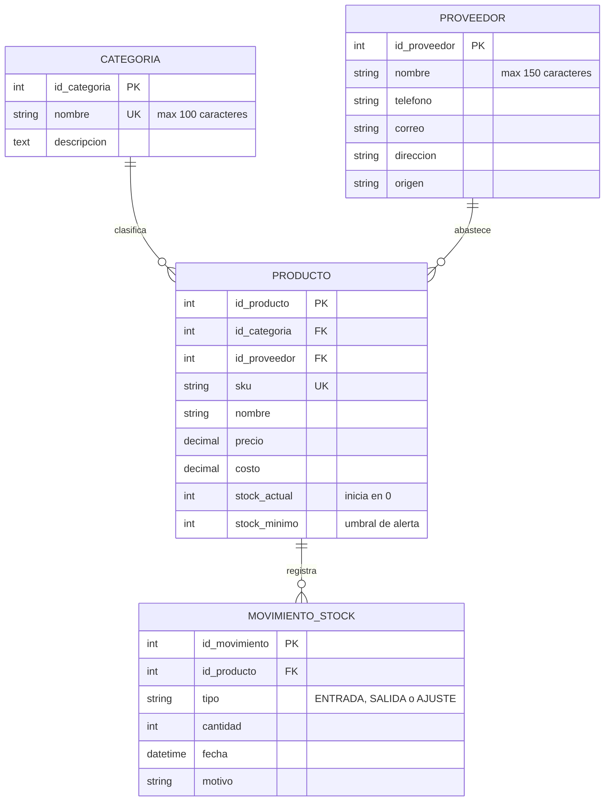

# 🚀 StockFlow API

## 📖 Descripción del Proyecto

**StockFlow API** es una API REST que centraliza y automatiza el control de inventario multicanal. Permite administrar el catálogo de productos, organizarlos por categorías, registrar a los proveedores que los abastecen y llevar un historial completo de cada entrada, salida o ajuste de existencias.

Está pensada para tiendas físicas, comercios electrónicos, almacenes y desarrolladores de software que necesitan una fuente única y confiable del inventario. Hoy muchos de estos negocios controlan sus existencias en hojas de Excel, lo que produce errores de digitación, información desactualizada entre canales y pérdidas por quiebres de stock (no hay producto cuando se necesita) o por sobre-stock (capital inmovilizado en mercancía que no rota).

El núcleo del diseño es la **trazabilidad**: el stock de un producto nunca se edita a mano, sino que cambia únicamente a través de movimientos registrados (entrada, salida o ajuste) que no se pueden modificar ni borrar. Así, cualquier existencia se puede explicar con su historial, y el sistema puede alertar cuando un producto baja de su stock mínimo.

### ✅ Elevator Pitch (Hito 1)

| Pregunta | Respuesta |
|----------|-----------|
| **¿Qué es?** | API REST que centraliza y automatiza el control de inventario multicanal. |
| **¿Para quién es?** | Tiendas físicas, e-commerce, almacenes y desarrolladores de software. |
| **¿Qué problema resuelve?** | Elimina hojas de Excel y evita pérdidas por quiebres o sobre-stock. |

**Dominio:** Gestión de Inventarios y Cadena de Suministros.

## 🎥 Video de Presentación
* 🎬 **Enlace al video de presentación (Máx. 5 minutos):** _Pendiente: se agrega aquí cuando el equipo publique el video._

## 👥 Equipo de Desarrollo

| Nombre | Rol | GitHub |
|--------|-----|--------|
| Brayan Morales | Líder / Arquitecto de Software | [@Luis10469](https://github.com/Luis10469) |
| Jhon Vasquez | Analista de Datos | _por confirmar_ |
| Hemery Perez | Diseñador de API | _por confirmar_ |
| Luis Alejandro Quiros | Documentación y QA | _por confirmar_ |

## 🏗️ Modelo de Datos (Entidades)
El sistema se compone de las siguientes 4 entidades principales y sus relaciones:
1. **Categoria**: Estructura para agrupar y organizar los artículos según su naturaleza o departamento comercial. Facilita búsquedas filtradas y reportes consolidados.
2. **Proveedor**: Entidad externa que suministra los productos, con sus datos de contacto y origen. Representa la fuente de aprovisionamiento en la cadena de suministro.
3. **Producto**: Núcleo del dominio. Elemento de inventario con SKU único, nombre, precio, costo, existencias actuales y umbral de stock mínimo.
4. **Movimiento_Stock**: Registro transaccional inmutable que documenta cada entrada, salida o ajuste de un producto, con fecha, cantidad y motivo.

### Diagrama Entidad-Relación

### Relaciones

| Relación | Cardinalidad | Significado |
|----------|--------------|-------------|
| Categoria → Producto | 1:N | Una categoría clasifica cero o muchos productos; cada producto pertenece a exactamente una categoría. |
| Proveedor → Producto | 1:N | Un proveedor abastece cero o muchos productos; cada producto tiene exactamente un proveedor. |
| Producto → Movimiento_Stock | 1:N | Un producto registra cero o muchos movimientos; cada movimiento afecta exactamente a un producto. |

### Reglas de negocio
* El `sku` de un producto y el `nombre` de una categoría son únicos.
* `stock_actual` no se edita directamente: solo cambia al registrar un movimiento (ENTRADA suma, SALIDA resta, AJUSTE corrige).
* Un movimiento de SALIDA no puede dejar el stock en negativo (la API responde `409 Conflict`).
* Los movimientos son inmutables: no se actualizan ni se eliminan. Un error se corrige con un nuevo movimiento de tipo AJUSTE.
* Cuando `stock_actual` es menor o igual que `stock_minimo`, el producto se considera en **stock bajo**.
* No se puede eliminar una categoría o un proveedor que tenga productos asociados, ni un producto que tenga movimientos (integridad referencial, `409 Conflict`).

## 🔌 Documentación de Endpoints (API Design)
A continuación se detallan los endpoints diseñados bajo estándares RESTful: sustantivos en plural, kebab-case para nombres compuestos (`movimientos-stock`), métodos HTTP según la acción y versionado en la URL.

Base URL propuesta: `http://localhost:3000/api/v1`

### 1. Recurso: Categoria (`/categorias`)

| Método | Endpoint | Descripción | Payload (Body) | Respuesta Esperada |
|--------|----------|-------------|----------------|--------------------|
| GET | `/categorias` | Listar todas las categorías | N/A | 200 OK (Array) |
| GET | `/categorias/:id` | Obtener una categoría | N/A | 200 OK (Object) / 404 Not Found |
| POST | `/categorias` | Crear una categoría | `{ "nombre": "Textil", "descripcion": "Ropa y telas" }` | 201 Created |
| PATCH | `/categorias/:id` | Actualizar datos de la categoría | `{ "nombre": "Textil Premium" }` | 200 OK |
| DELETE | `/categorias/:id` | Eliminar una categoría sin productos | N/A | 204 No Content / 409 Conflict |

### 2. Recurso: Proveedor (`/proveedores`)

| Método | Endpoint | Descripción | Payload (Body) | Respuesta Esperada |
|--------|----------|-------------|----------------|--------------------|
| GET | `/proveedores` | Listar todos los proveedores | N/A | 200 OK (Array) |
| GET | `/proveedores/:id` | Obtener un proveedor | N/A | 200 OK (Object) / 404 Not Found |
| POST | `/proveedores` | Registrar un proveedor | `{ "nombre": "Textiles Andinos", "telefono": "3001234567", "correo": "ventas@ejemplo.com", "direccion": "Calle 10 # 20-30", "origen": "Medellín" }` | 201 Created |
| PATCH | `/proveedores/:id` | Actualizar datos de contacto | `{ "telefono": "3009876543" }` | 200 OK |
| DELETE | `/proveedores/:id` | Eliminar un proveedor sin productos | N/A | 204 No Content / 409 Conflict |

### 3. Recurso: Producto (`/productos`)

| Método | Endpoint | Descripción | Payload (Body) | Respuesta Esperada |
|--------|----------|-------------|----------------|--------------------|
| GET | `/productos` | Listar todos los productos | N/A | 200 OK (Array) |
| GET | `/productos?bajo_stock=true` | Listar productos con `stock_actual <= stock_minimo` | N/A | 200 OK (Array) |
| GET | `/productos/:id` | Obtener un producto | N/A | 200 OK (Object) / 404 Not Found |
| POST | `/productos` | Crear un producto (inicia con `stock_actual` en 0) | `{ "sku": "CAM-001", "nombre": "Camisa Algodón", "id_categoria": 1, "id_proveedor": 2, "precio": 45000, "costo": 25500, "stock_minimo": 10 }` | 201 Created / 409 Conflict (SKU repetido) |
| PATCH | `/productos/:id` | Actualizar datos del producto (no el stock) | `{ "costo": 27000, "stock_minimo": 15 }` | 200 OK |
| DELETE | `/productos/:id` | Eliminar un producto sin movimientos | N/A | 204 No Content / 409 Conflict |

### 4. Recurso: Movimiento_Stock (`/movimientos-stock`)

| Método | Endpoint | Descripción | Payload (Body) | Respuesta Esperada |
|--------|----------|-------------|----------------|--------------------|
| GET | `/movimientos-stock` | Listar todos los movimientos | N/A | 200 OK (Array) |
| GET | `/movimientos-stock?tipo=SALIDA&desde=2026-10-01&hasta=2026-10-31` | Filtrar movimientos por tipo y rango de fechas | N/A | 200 OK (Array) |
| GET | `/movimientos-stock/:id` | Obtener un movimiento | N/A | 200 OK (Object) / 404 Not Found |
| POST | `/movimientos-stock` | Registrar una entrada, salida o ajuste (actualiza `stock_actual`) | `{ "id_producto": 10, "tipo": "ENTRADA", "cantidad": 50, "motivo": "Compra a proveedor" }` | 201 Created / 409 Conflict (stock insuficiente) |

> Los movimientos no tienen `PUT`, `PATCH` ni `DELETE`: son registros inmutables para garantizar la trazabilidad. Esos métodos responden `405 Method Not Allowed`. La `fecha` la asigna el servidor al momento del registro.

### 5. Endpoints de Relación (Anidados)
*Endpoints que cruzan entidades.*

| Método | Endpoint | Descripción | Payload (Body) | Respuesta Esperada |
|--------|----------|-------------|----------------|--------------------|
| GET | `/categorias/:id/productos` | Obtener los productos de una categoría | N/A | 200 OK (Array) |
| GET | `/proveedores/:id/productos` | Obtener los productos que abastece un proveedor | N/A | 200 OK (Array) |
| GET | `/productos/:id/movimientos-stock` | Obtener el historial de movimientos de un producto | N/A | 200 OK (Array) |
| POST | `/productos/:id/movimientos-stock` | Registrar un movimiento asociado a un producto | `{ "tipo": "SALIDA", "cantidad": 5, "motivo": "Venta tienda física" }` | 201 Created / 409 Conflict |

### Códigos de respuesta

| Código | Uso en la API |
|--------|---------------|
| 200 OK | Consulta o actualización exitosa. |
| 201 Created | Recurso creado. |
| 204 No Content | Recurso eliminado. |
| 400 Bad Request | Datos inválidos (campos obligatorios vacíos, cantidad no válida, intento de editar `stock_actual`). |
| 404 Not Found | El recurso con ese `id` no existe. |
| 405 Method Not Allowed | Intento de editar o borrar un movimiento. |
| 409 Conflict | SKU o nombre repetido, stock insuficiente o eliminación de un registro con dependencias. |

## 🛠️ Stack Tecnológico Propuesto
* **Lenguaje:** Node.js
* **Framework:** Express
* **Base de Datos:** PostgreSQL
* **Autenticación:** JWT

## 📅 Roadmap / Próximos Pasos
1. Configurar entorno de desarrollo.
2. Crear migraciones de base de datos basadas en el ER.
3. Implementar controladores para los endpoints GET.
4. Implementar los endpoints POST, PATCH y DELETE con sus validaciones y reglas de negocio.
5. Registrar cada movimiento y actualizar `stock_actual` dentro de una misma transacción.
6. Agregar autenticación con JWT y documentar la API con OpenAPI (Swagger).

## 🔗 Enlaces
* **Repositorio GitHub:** [https://github.com/Luis10469/api-design-stockflow](https://github.com/Luis10469/api-design-stockflow)
* **Video de Presentación:** https://drive.google.com/file/d/1l61wwK7GHJ7K4jYNGbfmbWXlk56YrsuW/view?usp=sharing 
---
**⚠️ Nota:** Este repositorio contiene solo la documentación y diseño. No incluye código fuente de la aplicación.
